<div align="center">

<picture>
  <source media="(prefers-color-scheme: dark)" srcset=".github/assets/banner-dark.svg">
  
</picture>

**See every state transition, and replay it deterministically.**<br>
A bounded, redacted recorder for events, snapshots, mutations, frames, performance marks, errors and network work. Export one JSON artifact for bug reports or CI.

[](https://packagist.org/packages/pushinbr/pam-native-devtools)
[](https://github.com/push-in/pam-native-devtools/releases/latest)

[](https://github.com/push-in/pam-native-devtools/actions/workflows/ci.yml)
[](LICENSE)

[Install](#install) · [Quick example](#quick-example) · [API](#api-guide) · [Checklist](#production-checklist) · [Docs](#docs) · [Issues](https://github.com/push-in/pam-native-devtools/issues)

</div>

<a id="install"></a>
## <picture></picture> Install

Inside a PAM Native project:

```sh
pam composer require pushinbr/pam-native-devtools
pam doctor --fix
```

This package is plain PHP (no plugin manifest, no native permissions); `pam doctor --fix` validates the environment and regenerates native integration when required. New to PAM? Create a project with `pam init my-app --template native` and run it with `pam mobile dev` (see the [PAM Native overview](https://push-in.github.io/pam-docs/native/overview/)), then come back here. Composer owns the manifest and the lockfile; `pam composer` runs it on PAM's verified PHP runtime. Remove it with `pam composer remove pushinbr/pam-native-devtools`.

<a id="quick-example"></a>
## <picture></picture> Quick example

```php
<?php

use Pam\Native\DevTools\DevTools;
use Pam\Native\DevTools\ReplaySession;
use Pam\Native\DevTools\TimelineRecording;

$tools = new DevTools();

$tools->snapshot('session', $session);
$tools->mutation('session', $previousSession, $session);
$tools->frame('feed', ['refreshRateHz' => 120, 'frameMs' => 7.4, 'missed' => false]);
$tools->mark('feed.start');
$request = $tools->network('GET', $url, $headers);
try { $request->complete(200, $responseHeaders, $body); }
catch (Throwable $e) { $request->fail($e->getMessage()); throw $e; }
$tools->measure('feed.load', 'feed.start');

$artifact = $tools->exportJson();
$recording = TimelineRecording::fromJson($artifact);
$replay = new ReplaySession($recording);
$replay->replay(static function (array $record): void {
    // Feed the exact, ordered diagnostic event into a test or inspector.
});
```

Sensitive keys are redacted recursively, object depth and collection size are bounded, strings are truncated, and the oldest records are discarded under pressure. The package complements PAM's native debug overlay and navigation timeline; it does not ship UI into production applications.

<a id="platform-support"></a>
## <picture></picture> Platform support

| Platform | Support | Notes |
| --- | --- | --- |
| PAM Native | `^0.8 \|\| ^0.9 \|\| ^0.10 \|\| ^1.0` | From `composer.json` |
| PHP | 8.5+ | Requires `ext-json` |
| Android / iOS | Whatever the PAM Native host supports | Pure PHP: no plugin manifest, permissions or native code of its own |

<a id="api-guide"></a>
## <picture></picture> API guide

| API | Responsibility |
| --- | --- |
| `DevTools` | Record events, mutations, snapshots, frames, marks, measures, errors, and network work. |
| `NetworkTransaction` | Complete, fail or cancel a captured request lifecycle. |
| `Redactor` | Bound and recursively redact diagnostic values. |
| `TimelineRecording` | Validate and serialize the bounded, versioned replay artifact. |
| `ReplaySession` | Step, seek, time travel to state, or replay the timeline deterministically. |
| `RecordKind` / `NetworkState` | Typed diagnostic record states. |

All coded states, kinds, and variants are sequential integer-backed enums. Use enum cases in application code; do not depend on raw wire numbers.

<a id="production-checklist"></a>
## <picture></picture> Production checklist

- Keep DevTools in development and diagnostic builds.
- Add product-specific sensitive keys to redaction rules.
- Attach exported JSON to reproducible bug reports, never public issue bodies without review.
- Run `pam doctor`, `pam test`, and a signed release build on every supported platform.
- Exercise denial, cancellation, backgrounding, process restart, and offline behavior before release.

<a id="troubleshooting"></a>
## <picture></picture> Troubleshooting

- **Records disappear:** the buffer intentionally drops oldest entries under pressure.
- **Values are truncated:** increase detail only when the privacy and size trade-off is acceptable.
- **A request remains open:** always call `complete()`, `fail()` or `cancel()`.
- **Native integration is stale:** run `pam doctor --fix`, rebuild the native host, and inspect the first reported diagnostic.

Report security vulnerabilities through the repository security policy or GitHub private vulnerability reporting, not a public issue.

<a id="docs"></a>
## <picture></picture> Docs

- [Package guide on pam-docs](https://push-in.github.io/pam-docs/packages/native-devtools/)
- [PAM Native overview](https://push-in.github.io/pam-docs/native/overview/)
- [Plugin and native capability model](https://push-in.github.io/pam-docs/native/plugins/)
- [Changelog](CHANGELOG.md)
- [Report an issue](https://github.com/push-in/pam-native-devtools/issues)

<a id="pam-ecosystem"></a>
## <picture></picture> Part of the PAM ecosystem

PAM runs PHP natively on servers, desktops and phones. This repository is one piece of it.

| [**PAM**](https://github.com/push-in/pam) | [**PAM Desktop**](https://github.com/push-in/pam-desktop) | [**PAM Native**](https://github.com/push-in/pam-native) | [**Ecosystem**](https://github.com/push-in/pam#ecosystem) |
| --- | --- | --- | --- |
| the runtime and CLI | native desktop apps in PHP | native Android and iOS apps in PHP | every official package and plugin |

<sub>Docs: [push-in.github.io/pam-docs](https://push-in.github.io/pam-docs/introduction/) · [Issues](https://github.com/push-in/pam-native-devtools/issues)</sub>

<p align="center"><sub><a href="LICENSE">Apache License 2.0</a> · Made in Brazil by Pushin</sub></p>
